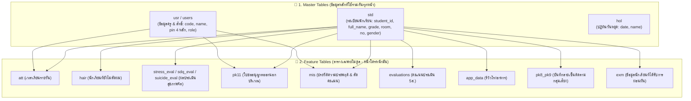

# คู่มือสถาปัตยกรรมระบบและมาตรฐานการพัฒนา (SBWK Architecture & Development Guide)
**โรงเรียนซับบอนวิทยาคม | ระบบบริหารจัดการกิจการนักเรียน**

เอกสารฉบับนี้จัดทำขึ้นเพื่อบันทึกโครงสร้างระบบ มาตรฐานการพัฒนา และขั้นตอนการเพิ่ม/แก้ไขหน้าเว็บอย่างเป็นทางการ เพื่อให้การพัฒนาในอนาคตเป็นไปในทิศทางเดียวกันอย่างถูกต้อง รวดเร็ว และไม่กระทบระบบเดิม

---

## 1. ปรัชญาและโครงสร้างระบบหลัก (Architecture Concept)

ระบบใช้สถาปัตยกรรม **Multi-Page Architecture (MPA)** ภายใต้แนวคิด **"หน้าใครหน้ามัน โค้ดใครโค้ดมัน (100% 1:1 HTML & JS Pairing)"**

* **ไม่มี JS ตัวกลางที่ผูกมัดทุกหน้า:** แต่ละหน้าทำงานเป็นอิสระ (Decoupled) ไม่ต้องโหลดสคริปต์ขนาดใหญ่ของหน้าอื่น
* **การแชร์ข้อมูล:** ใช้ฐานข้อมูล **Supabase Cloud** เป็นศูนย์กลางข้อมูลเพียงแห่งเดียว (Single Source of Truth)
* **การแชร์การตั้งค่า:** ใช้ [`config.js`](file:///d:/AI/sbwk-main/config.js) เก็บค่า URL, Anon Key และข้อมูลโรงเรียน
* **การแชร์การออกแบบ:** ใช้ [`styles.css?v=sbwk_clean`](file:///d:/AI/sbwk-main/styles.css) ร่วมกับฟอนต์ *Outfit* และ *Sarabun*

---

## 2. แผนผังการจับคู่ไฟล์หน้าบ้านและสคริปต์ (Page-to-Script Map)

| หน้าเว็บ (HTML) | สคริปต์ควบคุม (JS) | หน้าที่รับผิดชอบ | ตารางที่เกี่ยวข้องใน Supabase |
| :--- | :--- | :--- | :--- |
| **`index.html`** | [`app.js`](file:///d:/AI/sbwk-main/app.js) | เช็คชื่อหน้าเสาธง, แดชบอร์ดสถิติ, ติดตามนักเรียนกลุ่มเสี่ยง (ป.ค.8/9), ผ่อนผัน | `att`, `pk8_pk9`, `exm`, `std`, `usr`, `hol` |
| **`haircut.html`** | [`haircut.js`](file:///d:/AI/sbwk-main/haircut.js) | ตรวจระเบียบทรงผม, สวิตช์ Zero-Delay, ซิงค์สด Realtime, ตัวกรองชั้น/ห้อง/เพศ | `hair`, `std` |
| **`mental.html`** | [`mental.js`](file:///d:/AI/sbwk-main/mental.js) | แบบประเมินสุขภาพจิต (หมวด 1 เครียด/ซึมเศร้า, หมวด 2 SDQ, หมวด 3 เสี่ยงทำร้ายตนเอง 8Q), แดชบอร์ดรายงานผล | `stress_eval`, `sdq_eval`, `suicide_eval`, `std` |
| **`pk11.html`** | [`pk11.js`](file:///d:/AI/sbwk-main/pk11.js) | ขออนุญาตออกนอกบริเวณโรงเรียน (ป.ค. 11), กระดานเซ็นชื่อ, ส่งออก PDF | `pk11`, `std`, `usr` |
| **`misconduct.html`** | [`misconduct.js`](file:///d:/AI/sbwk-main/misconduct.js) | บันทึกพฤติกรรมนักเรียน, ตัดคะแนน, หักล้างพฤติกรรม, ยืนยันรหัส PIN ครู | `mis`, `std`, `usr` |
| **`clean5s.html`** | [`clean5s.js`](file:///d:/AI/sbwk-main/clean5s.js) | ประเมินความสะอาด 5ส., คำนวณเกรดเฉลี่ย, ส่งออกภาพรายงาน | `evaluations`, `std`, `usr` |
| **`canteen.html`** | [`canteen.js`](file:///d:/AI/sbwk-main/canteen.js) | ระบบประเมินและรีวิวร้านค้าในโรงอาหาร | `app_data` (module: canteen) |
| **`students.html`** | [`students.js`](file:///d:/AI/sbwk-main/students.js) | ทะเบียนนักเรียน (ตารางแก้ไขเลียนแบบ Sheet, ปุ่มแก้ไขใหญ่ Sheet Mode, แก้ไขรายคน, ปุ่ม เข้า/ออก หน้าสุด, พิมพ์ PDF) | `std` |

---

## 3. สถาปัตยกรรมฐานข้อมูล Supabase (Database Schema Design)

ฐานข้อมูลถูกแยกออกเป็น 2 ระดับอย่างชัดเจน:



* **กฎความปลอดภัย:** ห้ามแก้ไขโครงสร้างตาราง `std`, `usr`, `att` โดยไม่จำเป็น เพราะจะกระทบระบบเช็คชื่อหลัก

---

## 4. ขั้นตอนมาตรฐานการ "เพิ่มหน้าใหม่" (SOP for Adding a New Page)

เมื่อต้องการสร้างหน้าฟีเจอร์ใหม่ ให้ปฏิบัติตามขั้นตอนต่อไปนี้:

### ขั้นตอนที่ 1: สร้างไฟล์คู่หน้าบ้าน (`[feature].html` และ `[feature].js`)
1. สร้างไฟล์ HTML ใหม่ เช่น `dormitory.html`
2. สร้างไฟล์ JS ใหม่คู่กัน เช่น `dormitory.js`

### ขั้นตอนที่ 2: โครงสร้าง Template พื้นฐานของไฟล์ HTML ใหม่
```html
<!DOCTYPE html>
<html lang="th">
<head>
    <meta charset="UTF-8">
    <meta name="viewport" content="width=device-width, initial-scale=1.0">
    <title>ชื่อระบบ - โรงเรียนซับบอนวิทยาคม</title>
    
    <!-- Fonts & Icons -->
    <link href="https://fonts.googleapis.com/css2?family=Outfit:wght@300;400;600;700;800&family=Sarabun:wght@300;400;500;600;700&display=swap" rel="stylesheet">
    <link rel="stylesheet" href="https://cdnjs.cloudflare.com/ajax/libs/font-awesome/6.4.0/css/all.min.css">
    
    <!-- Shared Styles -->
    <link rel="stylesheet" href="styles.css?v=sbwk_clean">
</head>
<body>
    <!-- Navbar พร้อมปุ่มย้อนกลับไปหน้าแรก -->
    <header class="app-navbar">
        <a href="index.html" class="nav-brand">
            
            <div>
                <h3>ชื่อระบบ</h3>
                <p>โรงเรียนซับบอนวิทยาคม</p>
            </div>
        </a>
        <a href="index.html" class="btn-back-home">
            <i class="fa-solid fa-house"></i> หน้าแรก
        </a>
    </header>

    <main class="page-container">
        <!-- เนื้อหาเฉพาะของหน้านี้ -->
    </main>

    <!-- Essential Shared Scripts -->
    <script src="https://cdn.jsdelivr.net/npm/@supabase/supabase-js@2"></script>
    <script src="config.js?v=sbwk_clean" charset="utf-8"></script>

    <!-- Script เฉพาะของหน้านี้ (1:1) -->
    <script src="[feature].js?v=sbwk_clean" charset="utf-8"></script>
</body>
</html>
```

### ขั้นตอนที่ 3: โครงสร้าง Template พื้นฐานของไฟล์ JS ใหม่
```javascript
/**
 * [feature].js - ระบบ...
 */

// Helper ดึง Supabase Client
function getFeatureSupabase() {
    if (typeof getSupabase === "function") return getSupabase();
    if (window._supabaseInstance) return window._supabaseInstance;
    if (typeof window.supabase !== "undefined" && typeof GLOBAL_CONFIG !== "undefined") {
        window._supabaseInstance = window.supabase.createClient(GLOBAL_CONFIG.supabaseUrl, GLOBAL_CONFIG.supabaseKey);
        return window._supabaseInstance;
    }
    return null;
}

// Helper ดึงรายชื่อนักเรียนจาก Master Table 'std'
async function getStudentsSafe() {
    if (typeof students !== "undefined" && students && students.length > 0) return students;
    const db = getFeatureSupabase();
    if (db) {
        const { data } = await db.from('std').select('*').order('grade').order('room').order('no');
        return data || [];
    }
    return [];
}

// เริ่มต้นทำงานเมื่อ DOM พร้อม
document.addEventListener("DOMContentLoaded", async () => {
    // โหลดข้อมูลเฉพาะของหน้านี้
});
```

### ขั้นตอนที่ 4: เชื่อมโยงเมนูนำทาง (Navigation Link)
* เพิ่มปุ่มหรือไอคอนลิงก์จากหน้าแรก (`index.html`) หรือ Dock เมนู โดยชี้ไปที่ `[feature].html`

---

## 5. กฎเหล็กและข้อพึงระวัง (Critical Guidelines)

1. **ห้ามยุ่งกับ Firebase โดยเด็ดขาด:** ระบบย้ายมาอยู่บน **Supabase Cloud 100%** แล้ว
2. **ไม่ใช้คำสั่ง Terminal (`run_command`):** ให้ใช้เครื่องมือจัดการไฟล์ (`write_to_file`, `replace_file_content`, `view_file`) โดยตรงเท่านั้น
3. **รักษาความสมบูรณ์ของระบบเช็คชื่อหลัก:** การแก้ฟีเจอร์อื่นๆ ต้องไม่แตะต้องตรรกะเช็คชื่อหรือการคำนวณสถิติใน `index.html` และ `app.js`
4. **ความสม่ำเสมอของ UI/UX:** ใช้ฟอนต์ Sarabun (เนื้อหา) และ Outfit (หัวข้อ/ตัวเลข) เสมอ
